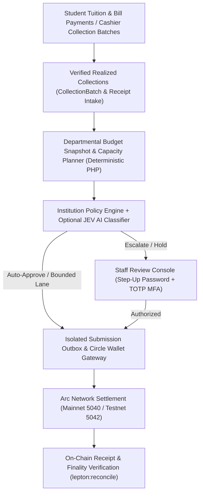

<div align="center">


<p>
  <a href="LICENSE"></a>
  
  
  
  
  
  
  
</p>

<p>
  <a href="https://opensinop.koamishin.com">Institutional app</a> ·
  <a href="#quick-start-local-development">Get started</a> ·
  <a href="#key-features">Key features</a> ·
  <a href="#production-readiness">Current limits</a> ·
  <a href="https://koamishin.github.io/OpenSinop/">Documentation</a>
</p>

# OpenSinop

**Deterministic Institutional Finance & Treasury Orchestration on Circle Agent Wallets + Arc**

Review verified student fee collections, plan departmental allocations against protected reserves, evaluate institutional policies with auditable AI advisory, and settle authorized USDC obligations on **Arc** via **Circle Wallets**.

</div>

---

> [!IMPORTANT]
> **Project Status:** OpenSinop is under active development. Self-hosting does not certify financial readiness for live institutional funds. Use simulated data (`LEPTON_DRIVER=fake`) or an explicitly authorized Arc testnet pilot, and review the [Production readiness](#production-readiness) gates before enabling payment execution.

## Table of Contents

- [Overview](#overview)
- [Key Features](#key-features)
- [Architecture & Design Principles](#architecture--design-principles)
- [Production readiness](#production-readiness)
- [Prerequisites](#prerequisites)
- [Quick Start (Local Development)](#quick-start-local-development)
- [Self-Hosting & Production Deployment](#self-hosting--production-deployment)
  - [Option A — Docker Swarm Installer (Recommended)](#option-a--docker-swarm-installer-recommended)
  - [Option B — Docker Compose](#option-b--docker-compose)
  - [Option C — Bare-Metal Production Setup](#option-c--bare-metal-production-setup)
- [Wallets, Circle & Arc Configuration](#wallets-circle--arc-configuration)
- [Core Workflows & Modules](#core-workflows--modules)
  - [Institution Onboarding & First Setup Wizard](#1-institution-onboarding--first-setup-wizard)
  - [Student Web3 Portal, Tuition & E-Receipts](#2-student-web3-portal-tuition--e-receipts)
  - [Institution Policy Studio & JEV Simulator](#3-institution-policy-studio--jev-simulator)
  - [JEV Decision Analytics & Live Agent Health](#4-jev-decision-analytics--live-agent-health)
  - [Collections, Departmental Planning & MFA Payment Review](#5-collections-departmental-planning--mfa-payment-review)
- [Developer Demo & Seeded Scenarios](#developer-demo--seeded-scenarios)
- [CLI Reference](#cli-reference)
- [Testing & Quality Assurance](#testing--quality-assurance)
- [Troubleshooting](#troubleshooting)
- [Project Structure](#project-structure)
- [Tech Stack](#tech-stack)
- [Contributing](#contributing)
- [License](#license)

---

## Overview

**OpenSinop** is an open-source, institution-owned financial orchestration platform built on the [Circle Agent Stack](https://developers.circle.com/agent-stack) and the [Arc](https://docs.arc.io) blockchain network.

Rather than acting as an unrestricted AI treasurer or replacing a college's core accounting system, OpenSinop addresses a concrete operational question: **what should an institution do with student fees already collected?**

OpenSinop combines **deterministic PHP financial policy enforcement** with **optional, fail-closed AI advisory (JEV)** and **verifiable on-chain USDC settlement**:

1. **Verify Collections:** Capture and reconcile student tuition, laboratory bills, and cashier collection batches, separating confirmed cash from expected revenue and restricted funds.
2. **Plan Departmental Budgets:** Evaluate approved vendor bills against departmental allocations, opening funds, realized receipts, and protected reserves.
3. **Evaluate & Simulate Policies:** Classify obligations against plain-English institutional policies using 1-click templates, an interactive JEV Decision Simulator, and background AI evaluation queues.
4. **Enforce Human Governance:** Route high-value or unverified disbursements to staff for step-up MFA (password + TOTP) review while allowing bounded, pre-authorized recurring mandates within strict caps.
5. **Settle & Reconcile on Arc:** Execute permitted USDC payments through Circle Agent Wallets or Developer-Controlled Wallets and verify on-chain receipts and finality on Arc.

---

## Key Features

| Area | Implemented Capabilities |
|---|---|
| **Multi-School Onboarding & Setup** | Self-service institution registration (`/institutions/register`) with **Arc Mainnet** (`5040`) and **Arc Testnet** (`5042`) support, followed by a guided **First Application Setup Wizard** (`/institutions/setup`) for budgets, 1-click policy templates, treasury binding, and student invite links. |
| **Student Web3 Portal & E-Receipts** | Dual-path student registration (`/register`) with 1-click EIP-1193 browser wallet signature verification (`personal_sign`) or manual EVM address entry. Full tuition and laboratory bill payment flows with locked quotes, fee ceilings, and downloadable **Official Payment E-Receipts**. |
| **Institution Policy Studio & Simulator** | Visual workspace (`/finance/policies`) featuring **5 curated 1-click policy templates**, plain-English policy versioning, an interactive **JEV Decision Simulator**, and live **AI & JEV Agent Health** connectivity probes. |
| **JEV Decision Analytics** | Executive ReUI analytics (`/finance/jev-analytics`) and Filament dashboard (`JevAnalyticsDashboard`) tracking `match`, `needs_review`, `hold`, and `exempt` verdicts, 14-day trajectories, category confidence, staff concurrence vs. override rates, and approval latency. |
| **Autonomous Pipeline Bridge** | Background pipeline (`eduflow:autonomous-pipeline-bridge`) that reconciles verified student tuition receipts into collection batches, runs JEV policy evaluation, plans departmental budgets, and disburses eligible vendor bills within configured USDC caps. |
| **Collections & Budget Planning** | Immutable cashier `CollectionBatch` intake with SHA-256 document digests, `InvoiceVersion` source evidence, and `BudgetSnapshot` planning via `DepartmentBudgetPlanner` using exact 6-decimal `Money` math. |
| **MFA-Backed Payment Governance** | Append-only `VendorDestinationVersion` approvals, 15-minute block-bound `FundingWindow` observations, atomic `PaymentReservation` holds, and step-up password + TOTP `PaymentAuthorization` by independently enrolled reviewers. |
| **Dual Staff Consoles + Student Chat** | Dedicated **Finance Panel** (`/finance`) and **Admin Panel** (`/admin`) built on Filament v5, smart role routing (`/console`), plus **Ask OpenSinop** student Q&A guarded by `BriefGuard` to prevent hallucinated financial figures. |

---

## Architecture & Design Principles



### Five Core Design Rules

1. **The LLM never moves money.** All financial eligibility, reserve checks, and cap decisions live in deterministic PHP (`FinancialPolicyEngine`, `EvaluateAssistancePolicy`, `DepartmentBudgetPlanner`). AI models classify context and explain decisions; they can tighten a verdict (one-way ratchet) but never override a policy failure or invent an amount.
2. **Exact money is required.** USDC uses 6 decimal places (`45.00` USDC = `45_000000` base units), while Arc native gas/balance reads use 18 decimals (`wei`). Arithmetic uses `App\DTOs\Money` and `Yukazakiri\Lepton\Support\Amounts`—never IEEE 754 floats or `hexdec()`.
3. **A transaction hash is a claim, not proof.** Storing a hash does not mean money settled. `lepton:reconcile` and `ArcSettlementVerifier` inspect on-chain receipts: only a confirmed successful receipt is marked `verified`, only a chain-reported failure is marked `reverted`, and a missing RPC result alone does not prove fabrication—those rows stay `unresolved` for human investigation.
4. **No hardcoded CLI shells.** Every Circle and Arc operation routes through injected [`yukazakiri/lepton-agent`](https://github.com/yukazakiri/lepton-agent) gateway contracts (`WalletGateway`, `ArcNetworkGateway`), enabling seamless switching between `circle` (CLI), `developer` (REST API), and `fake` (offline test/simulation) drivers.
5. **Simulated runs are visibly badged.** Running with `LEPTON_DRIVER=fake` executes entirely in memory, sets `is_fake` on every receipt, and badges the UI as **Simulated** so a developer demo is never mistaken for on-chain settlement.

---

## Production readiness

**Status: the SDK and webhook-ingestion blockers are closed; live provider validation and operational release gates are still open.** The application runs on Lepton [`v3.0.0-rc.1`](https://github.com/yukazakiri/lepton-agent/releases/tag/v3.0.0-rc.1)+ (`v3.0.0-rc.2` locked) and requires PHP 8.5. Neither a green test suite nor a package tag certifies the application for real institutional funds.

### What shipped

- **Hardened Lepton driver.** REST paths, `feeLevel`, signing payloads, bounded pagination, and wallet/network/wallet-set scoping match the Circle OpenAPI contract; mutations require a persisted UUID v4 idempotency key; unsupported operations throw `UnsupportedOperation` instead of inventing zero balances. Arc reads are HTTPS-only with verified chain identity and no CLI fallback. Exact six-decimal USDC; Arc native (18 dp) and ERC-20 (6 dp) views of the same balance are never summed.
- **Contained webhook ingestion.** `POST /api/webhooks/circle` returns `404` unless `lepton.webhooks.enabled` is set *and* the developer REST driver is selected. Missing signature or key headers return `401`. Raw bytes are verified against `GET /v2/notifications/publicKey/{keyId}` with `ECDSA_SHA_256` — never the Entity Secret RSA key. Notification type, subscription, network, and transaction identity are validated before anything is stored.
- **Durable inbox, no duplicate payments.** Each verified event is stored once with its payload digest; a reused `notificationId` with a different digest returns `409`. The response is `202` with `settlement_verified: false`, and the only side effect is a queued observation job. The webhook can never create or submit a payment, and never marks a bill paid.
- **Recovery without resend.** `ObserveCircleNotification` wakes only pre-existing submissions, tuition attempts, and bill payments for their own settlement processors, with overlap protection, exponential backoff, and a per-minute `app:recover-circle-notifications` sweep for unobserved hints.
- **Explicitly gated rail.** `CircleAgentWalletTransport` refuses a requested fee ceiling it cannot enforce, and refuses the developer REST rail outright until payer fee controls are reviewed rather than assuming a relayer sponsors it.

### Remaining release gates

1. **Separately authorized live testnet validation.** Circle wallet creation, signing, transfers, faucet eligibility, webhook delivery, and matched on-chain settlement have not been exercised in a certified live school environment. Offline tests do not cover them.
2. **Operational rehearsal.** Provider failures, worker crashes, replay, missed events, restart, update, and backup restoration.
3. **Secrets, authorization, and custody review.** Entity Secret registration and recovery custody, MFA-backed payment review, monitoring, alerting, and rollback before any controlled mainnet decision. No mainnet payment or custody migration is implicit.
4. **Exact receipt matching.** Legacy `transactions.amount` decimal columns still coexist with newer base-unit tables, so a verified legacy receipt is not by itself proof that *this* payment moved *this* exact amount to *this* recipient. Full receipt-level matching of token, sender, recipient, exact amount, and finality across all lanes remains a release gate.

See [PLAN.md](PLAN.md) for the complete financial, pilot, and release-safety roadmap.

---

## Prerequisites

| Requirement | Minimum Version | Notes & Installation |
|---|---|---|
| **Docker** (Self-hosting) | 24.0+ (Compose v2) | [Docker Engine](https://docs.docker.com/engine/install/) · [Docker Desktop](https://www.docker.com/products/docker-desktop/) |
| **PHP** (Local / Bare-metal) | **8.5+** (required) | Extensions: `pdo_sqlite` / `pdo_pgsql`, `mbstring`, `openssl`, `curl`, `bcmath`, `intl`, `zip` |
| **Composer** | 2.x | [getcomposer.org](https://getcomposer.org/download/) |
| **Node.js & npm** | 20.18.2+ | [nodejs.org](https://nodejs.org/en/download) |
| **Circle CLI** (Optional) | 1.1.4+ | Required only when `LEPTON_DRIVER=circle`: `npm install -g @circle-fin/cli` |
| **uv / arc-canteen** (Optional) | Latest | Optional helper CLI (`uv tool install arc-canteen`); Arc reads use direct HTTPS JSON-RPC |

---

## Quick Start (Local Development)

> [!WARNING]
> The local quick-start commands below run `migrate:fresh --seed`, which wipes the local SQLite database. Never run `migrate:fresh` on a production or pilot instance.

### Option 1 — One-Command Setup (Recommended)

```bash
git clone https://github.com/koamishin/OpenSinop.git
cd OpenSinop

composer run setup
```

`composer run setup` installs PHP and JS dependencies, copies `.env.example` to `.env`, generates `APP_KEY`, enables the `Blog` module, runs migrations and seeders, compiles frontend assets, and generates Filament Shield permissions.

Start the development stack (HTTP server, queue worker, Pail logs, and Vite HMR):

```bash
composer run dev
```

### Option 2 — Manual Step-by-Step Setup

```bash
git clone https://github.com/koamishin/OpenSinop.git
cd OpenSinop

composer install
npm install

cp .env.example .env
php artisan key:generate

touch database/database.sqlite
php artisan module:enable Blog --no-interaction
php artisan migrate:fresh --seed
php artisan module:migrate --force --no-interaction

npm run build
composer run dev
```

- **Offline / No-Credential Development:** Set `LEPTON_DRIVER=fake` in `.env` to simulate wallet balances, transfers, and receipts in memory without Circle credentials.
- **Health Check:** Run `php artisan lepton:doctor` at any time to verify your environment, wallet driver, and chain connectivity.

### Demo accounts

When seeded for the developer demo (`EduFlowFinancialSeeder`, `EducationDemoSeeder`, `EduFlowPlanSeeder`), the following demo accounts are available:

| Role | Email | Password |
|---|---|---|
| Student | `juan@eduflow.test` | `password` |
| Finance officer | `finance@eduflow.test` | `password` |

*(Local `DatabaseSeeder` also seeds a local super-admin account for development convenience; production installs create no default users.)*

---

## Self-Hosting & Production Deployment

OpenSinop supports three production deployment methods. Never use `migrate:fresh --seed` on a self-hosted instance.

### Option A — Docker Swarm Installer (Recommended)

The interactive installer (`install.sh` / `install.ps1`) deploys OpenSinop on Docker Swarm with the FrankenPHP/Octane application container (`opensinop`), PostgreSQL 16 (`opensinop-db`), and Redis 7 (`opensinop-redis`) on an overlay network, storing database credentials in Docker secrets. If Docker is missing on Linux, the installer can install it automatically across Debian/Ubuntu, RHEL/Fedora, openSUSE, Arch, Alpine, Void, and Gentoo.

Run from a dedicated installation directory:

- **Linux / macOS (bash, zsh):**
  ```bash
  bash <(curl -fsSL https://raw.githubusercontent.com/koamishin/OpenSinop/main/install.sh)
  ```
- **Fish shell:**
  ```fish
  curl -fsSL https://raw.githubusercontent.com/koamishin/OpenSinop/main/install.sh | bash
  ```
- **Windows (PowerShell):**
  ```powershell
  irm https://raw.githubusercontent.com/koamishin/OpenSinop/main/install.ps1 | iex
  ```

**Installer flags & environment variables:**
- `--yes` — Accept defaults non-interactively.
- `--update` — Dump PostgreSQL to `./backups/`, pull the latest image, and roll the `opensinop` service.
- `EDUFLOW_VERSION=<tag>` — Pin a specific container image tag.
- `ADVERTISE_ADDR=<ip>` — Specify the Swarm advertise address on multi-interface hosts.

**Updating an existing Swarm deployment:**
```bash
bash <(curl -fsSL https://raw.githubusercontent.com/koamishin/OpenSinop/main/install.sh) --update
```
*(Always verify an independent backup of your database, storage volume, and `.env` `APP_KEY` before updating.)*

**Bootstrapping the first administrator (Swarm):**
```bash
docker exec -it "$(docker ps -q -f label=com.docker.swarm.service.name=opensinop | head -n1)" \
  php artisan app:bootstrap-admin --name="School Operator" --email="operator@example.org"
```

### Option B — Docker Compose

For a standard single-host Docker Compose deployment:

```bash
docker compose -f https://raw.githubusercontent.com/koamishin/OpenSinop/main/docker-compose.yml up -d
```

Bootstrap the first administrator:
```bash
docker exec -it opensinop php artisan app:bootstrap-admin --name="School Operator" --email="operator@example.org"
```

Update a Compose deployment:
```bash
docker compose pull && docker compose up -d
```

### Option C — Bare-Metal Production Setup

1. **Clone and build:**
   ```bash
   git clone https://github.com/koamishin/OpenSinop.git /var/www/opensinop
   cd /var/www/opensinop
   composer install --no-dev --optimize-autoloader
   npm ci && npm run build
   ```
2. **Configure `.env`:**
   ```bash
   cp .env.example .env
   php artisan key:generate
   ```
   Set `APP_ENV=production`, `APP_DEBUG=false`, `APP_URL=https://your-domain.example`, and configure PostgreSQL (`DB_CONNECTION=pgsql`) and Redis/Database queues.
3. **Migrate & initialize school identity:**
   ```bash
   php artisan module:enable Blog --no-interaction
   php artisan migrate --force --no-interaction
   php artisan module:migrate --force --no-interaction
   php artisan storage:link
   php artisan app:install --institution="Pilot School" --country=PH --timezone=Asia/Manila --currency=PHP --no-interaction
   php artisan app:bootstrap-admin --name="School Operator" --email="operator@school.example"
   ```
4. **Cache configuration & run workers:**
   ```bash
   php artisan config:cache
   php artisan route:cache
   php artisan view:cache
   php artisan event:cache
   ```
   Supervise long-running workers via Supervisor or systemd:
   ```bash
   php artisan queue:work --queue=student-tuition,student-bills,finance-submission,finance-planning,policy-assessments,default --sleep=3 --tries=3
   php artisan schedule:work
   ```

---

## Wallets, Circle & Arc Configuration

OpenSinop uses [`yukazakiri/lepton-agent`](https://github.com/yukazakiri/lepton-agent) (`v3.0.0-rc.1`+ / `v3.0.0-rc.2`) to interact with Circle Wallets and the Arc network.

```env
# Driver selection:
#   fake      = In-memory simulated ledger (offline demos & automated tests)
#   circle    = Circle Agent Stack CLI + Arc HTTPS JSON-RPC (requires Circle CLI & MPC agent wallet)
#   developer = Circle Developer-Controlled Wallets pure HTTP REST API (zero CLI binaries)
LEPTON_DRIVER=circle
LEPTON_CIRCLE_BIN=circle
LEPTON_ARC_BIN=arc-canteen
LEPTON_CHAIN=ARC-TESTNET
LEPTON_CHAIN_ID=5042002
LEPTON_TREASURY_ADDRESS=0xYourAgentWallet
LEPTON_RPC_URL=
LEPTON_DRY_RUN=false
LEPTON_ALLOW_RAW_CIRCLE=false

# Optional: Circle Developer-Controlled Wallets REST API (when LEPTON_DRIVER=developer)
LEPTON_CIRCLE_API_KEY=
LEPTON_ENTITY_SECRET=
LEPTON_WALLET_SET_ID=
LEPTON_CIRCLE_API_URL=https://api.circle.com/v1/w3s

# Optional: Verified Circle Webhook Notifications
LEPTON_WEBHOOKS_ENABLED=false
LEPTON_WEBHOOK_SUBSCRIPTIONS=
LEPTON_WEBHOOK_MAX_AGE_SECONDS=86400
```

### Authenticating & Funding a Circle Agent Wallet (`LEPTON_DRIVER=circle`)

Circle agent wallets authenticate via email OTP (sessions last 7 days). **Mainnet and testnet authenticate independently**—a valid mainnet session does not authorize an `ARC-TESTNET` transfer.

```bash
# 1. Check current session state
php artisan lepton:login --status

# 2. Request an email OTP (expires in 10 minutes)
php artisan lepton:login you@example.com

# 3. Complete login with the request ID and OTP code
php artisan lepton:login --request=<request-id> --otp=B1X-123456
```

**Funding on Arc Testnet:**
```bash
circle wallet fund --address <your-agent-wallet> --chain ARC-TESTNET
```
> [!NOTE]
> The Circle testnet faucet mints **20 USDC per call** (ignoring `--amount`) and rate-limits with HTTP `429` after roughly 5 calls, giving a practical ceiling of **100–120 USDC** per wallet. Also remember that **USDC is the gas token on Arc**, so a wallet requires a nonzero USDC balance to broadcast any transaction.

Verify your setup and reconcile receipts against the chain:
```bash
php artisan lepton:doctor
php artisan lepton:status --address=0xYourAgentWallet
php artisan lepton:reconcile
```

---

## Core Workflows & Modules

### 1. Institution Onboarding & First Setup Wizard

OpenSinop supports both single-institution installations (`php artisan app:install`) and multi-school shared-database onboarding:
- **Institution Registration (`/institutions/register`):** Register an organization, select **Arc Mainnet** (`5040`) or **Arc Testnet** (`5042`), choose an accounting currency (`USDC` or `EURC`), and link a Circle Agent Wallet or manual EVM treasury address.
- **First Application Setup Wizard (`/institutions/setup`):** Newly registered schools are guided through configuring initial department budgets, activating a 1-click institutional policy template, verifying their Arc treasury connection, and generating student registration invite links. Student registration and login remain gated until `is_setup_completed` is true.
- **Smart Console Redirect (`/console`):** Routes authenticated finance officers and administrators directly to `/finance` or `/admin`.

### 2. Student Web3 Portal, Tuition & E-Receipts

Students enroll at `/register` and access their portal at `/dashboard`:
- **1-Click Web3 Wallet Linking:** Connect MetaMask, Rainbow, Phantom, or any EIP-1193 wallet with cryptographic signature verification (`personal_sign`) to prove ownership, or enter a 40-hex EVM address manually.
- **Tuition & Bill Payments (`/student/pay`, `/student/bills`):** Request a locked quote with an explicit sender-fee guarantee, review the exact 6-decimal USDC breakdown, and submit payment consent.
- **Official Payment E-Receipt Modal:** View and print tamper-evident electronic receipts linking student details, payment reference, policy evaluation, and Arc block explorer transaction proof.

### 3. Institution Policy Studio & JEV Simulator

Available at `/finance/policies` (and linked from both Filament panels):
- **1-Click Policy Templates:** Instantly initialize policies using five curated templates:
  1. *Standard Academic Operations*
  2. *Campus Events & Student Life*
  3. *STEM & Lab Research*
  4. *Autonomous Fast-Track*
  5. *Strict Governance & Audit*
- **Interactive JEV Decision Simulator:** Test hypothetical bills, amounts, and categories against the active policy to inspect step-by-step plain-English reasoning and disposition (`match`, `needs_review`, `hold`, `exempt`) before publishing.
- **Immutable CLI Policy Governance:** Operators can also draft and activate low-level numeric policy versions via `php artisan app:prepare-finance-policy` and `php artisan app:activate-finance-policy` (enforcing two-person separation where the reviewer cannot be the creator).

### 4. JEV Decision Analytics & Live Agent Health

- **Executive Analytics (`/finance/jev-analytics` & Filament `JevAnalyticsDashboard`):** Tracks AI evaluation throughput, decision breakdowns (`match`, `needs_review`, `hold`, `exempt`), category confidence distributions, 14-day trend trajectories, **Staff Concurrence Rate**, **Manual Override Rate**, and **Time-to-Approval Latency**.
- **Live Agent Health Checks (`/finance/ai/health`):** Interactive connectivity diagnostics probing the configured AI provider (`local`, `openai-compatible`, `openai`, `anthropic`, etc.) and JEV policy brain, with one-click advisory toggling.
- **Fail-Closed AI Guarantees:** API keys stored in the database (`ai_providers`) are encrypted at rest via `APP_KEY` and never echoed back to the DOM. If an AI endpoint times out or returns malformed output, OpenSinop fails closed and relies strictly on deterministic PHP rules.
- **Ask OpenSinop (`AskEduFlow` + `BriefGuard`):** Student chat computes answers deterministically in PHP first (`StudentBrief`). If an LLM rephrases the response, `BriefGuard` extracts every digit string and rejects the response if any number deviates from the brief.

### 5. Collections, Departmental Planning & MFA Payment Review

<details>
<summary><strong>Detailed evidence, reservation, and step-up MFA lifecycle</strong></summary>

- **Reviewed Aggregate Fee Collections (`CollectionBatch`):** Cashier staff record batch receipts (`POST finance/collection-batches`) with SHA-256 document digests and disjoint half-open collection intervals. A separate verified admin reviews (`POST finance/collection-batches/{collectionBatch}/review`) to approve, hold, or reject receipts before they can fund any budget plan.
- **Invoice Source Evidence (`InvoiceVersion`) & Budget Snapshots (`BudgetSnapshot`):** Staff capture verified invoice valuations (`POST finance/invoice-versions`) and departmental budget snapshots (`POST finance/budget-snapshots`). `DepartmentBudgetPlanner` checks bills cumulatively by due date, keeping budget allocations separate from realized cash, restricted funds, and protected reserves.
- **Reviewed Vendor Destinations (`VendorDestinationVersion`) & Drafts (`PaymentIntent`):** Vendor wallet addresses require independent admin approval (`POST finance/vendor-destinations/{vendorDestinationVersion}/approve`). `php artisan app:prepare-vendor-payment` creates an immutable, SHA-256-digested full-bill draft.
- **Bounded Funding Windows (`FundingWindow`) & Reservations (`PaymentReservation`):** `POST finance/funding-windows` binds approved budget evidence and a fresh block-bound Arc balance (15-minute max lifetime). `POST finance/payment-intents/{paymentIntent}/reserve` places an atomic capacity hold covering bill amount + maximum fee.
- **Step-Up MFA Payment Review (`PaymentAuthorization`):** Reviewers must hold direct `AuthorizePayment:PaymentIntent` permission and have their TOTP factor pinned by a separate administrator (`POST finance/payment-reviewers/{reviewer}/enroll`). Approving a held payment (`POST finance/payment-intents/{paymentIntent}/authorize` or via Filament **Payment Reviews**) requires a fresh password and unused 6-digit TOTP code.
- **Receipt Verification (`lepton:reconcile`):**
  | Verdict | Meaning | Action Taken |
  |---|---|---|
  | `verified` | On-chain receipt exists and reports status `0x1` (success) | Confirmed on-chain execution |
  | `reverted` | On-chain receipt exists and reports failure | Marked failed when running `lepton:reconcile --fix` |
  | `pending` | Transaction known to RPC, no receipt mined yet | Left in-flight |
  | `unresolved` | Hash not found on RPC | Left untouched for human investigation (never auto-failed) |
  | `observed` | Provider reports completion, chain receipt unreadable | Provider claim only |
  | `unverifiable` | Neither chain nor provider reachable | Retried later |
  | `ledger_only` | Local ledger row with no transaction hash | No chain claim |

</details>

---

## Developer Demo & Seeded Scenarios

To explore the autonomous policy engine against realistic seeded invoices and an emergency student aid request:

```bash
php artisan lepton:doctor      # Verify toolchain & configuration
php artisan app:demo           # Run one autonomous evaluation & settlement cycle
php artisan lepton:reconcile   # Verify stored transaction hashes against Arc
```

### The Seeded Scenarios

The developer demo (`EduFlowFinancialSeeder`, `EducationDemoSeeder`, `EduFlowPlanSeeder`) is calibrated for a **120 USDC wallet**, a **20 USDC reserve**, and a **50 USDC autonomous limit**. The deterministic policy engine evaluates **vendor verification → budget capacity → reserve safety → autonomous limit** in order:

| Invoice Reference | Amount (USDC) | Decision | Policy Rule / Reason |
|---|---:|---|---|
| `INV-FIBER-30` | 30.00 | **AUTO_APPROVE** | Verified telecom vendor, within budget & under the 50 USDC limit |
| `INV-CLOUD-45` | 45.00 | **AUTO_APPROVE** | Verified cloud vendor, within budget & under the 50 USDC limit |
| `INV-UNVERIFIED-60` | 60.00 | **ESCALATE** | Vendor is unverified (`pending` status checked first) |
| `INV-LAB-90` | 90.00 | **ESCALATE** | Verified vendor, but exceeds the 50 USDC autonomous limit |
| `INV-SUPPLY-200` | 200.00 | **HOLD** | Paying 200 USDC would breach the mandatory 20 USDC reserve |
| `INV-HAZARD-2000` | 2000.00 | **REJECT** | Exceeds the 500 USDC equipment budget allocation |

In addition, the demo evaluates one emergency student assistance request for **15 USDC** against a **10 USDC** auto-limit (`BOUNDED_EMERGENCY_AID_V1`), resulting in a bounded split: **10 USDC** approved immediately and **5 USDC** escalated for staff review.

Only the two auto-approved invoices and the approved aid portion move funds: **85 USDC** (`(30 + 45 + the 10 USDC aid` portion). Under `LEPTON_DRIVER=circle`, `app:demo` is **not a simulation** and spends 85 USDC of testnet funds; under `LEPTON_DRIVER=fake`, everything runs in memory and badges receipts as **Simulated** so you can never mistake a fake run for real settlement.

---

## CLI Reference

| Command | Description |
|---|---|
| `php artisan lepton:doctor` | **Run first.** Diagnoses CLI binaries, Circle session, treasury address, Arc RPC reads, and ledger parity. |
| `php artisan lepton:login` | Authenticate Circle agent wallet via email OTP (`<email>`, `--request=<id> --otp=<code>`, or `--status`). |
| `php artisan lepton:status` | Display current Arc block number, wallet balance, and spending limits (`--address=0x...`). |
| `php artisan lepton:wallet` | Manage Circle agent wallets (`lepton:wallets`, `lepton:wallet:create`, `lepton:wallet:fund`). |
| `php artisan lepton:transfer` | Execute or `--estimate` a single integer-base-unit USDC transfer via Lepton. |
| `php artisan lepton:reconcile` | Verify stored transaction receipts against Arc (`--fix` marks only chain-reverted rows failed). |
| `php artisan app:install` | Initialize single-school identity, currency, and conservative security defaults idempotently. |
| `php artisan app:bootstrap-admin` | Interactively create the first super-administrator account with hidden password prompts. |
| `php artisan app:demo` | Run the seeded developer demo cycle (auto-pay, escalate, hold, reject, and split aid). |
| `php artisan app:finance-preview` | Read-only C0 institution treasury and vendor bill forecast without modifying state (`--days=30`). |
| `php artisan app:draft-institution-policy` | Preview or save an institution-specific collections and bill-allocation policy draft. |
| `php artisan app:prepare-finance-policy` | Prepare an immutable, inactive numeric finance policy version (`--reserve`, `--auto-limit`, `--daily-limit`). |
| `php artisan app:activate-finance-policy` | Activate a prepared finance policy version with independent reviewer attestation. |
| `php artisan app:prepare-vendor-payment` | Prepare an immutable SHA-256 vendor payment draft bound to active policy and destination evidence. |
| `php artisan app:dispatch-finance-workflows` | Recover and dispatch queued read-only departmental finance planning workflows. |
| `php artisan app:dispatch-policy-evaluations` | Sweep and dispatch pending JEV institutional policy evaluations to background workers. |
| `php artisan app:dispatch-payment-submissions` | Hand durably authorized payment submissions to workers and recover expired leases (`--recover-stale`). |
| `php artisan app:reconcile-payment-submissions` | Verify submitted payment references against Arc and record proven settlements. |
| `php artisan app:dispatch-mandate-occurrences` | Classify due recurring obligations against approved standing mandates. |
| `php artisan app:dispatch-student-tuition` | Dispatch consented student tuition payment attempts for processing/observation. |
| `php artisan app:reconcile-tuition-receipts` | Reconcile settled student tuition movements into Collections intake. |
| `php artisan app:dispatch-student-bill-payments` | Dispatch consented student non-tuition bill payments. |
| `php artisan app:reconcile-student-bill-receipts` | Reconcile settled student bill receipts into Collections intake. |
| `php artisan app:recover-circle-notifications` | Re-queue verified Circle webhook notifications that remain unobserved. |
| `php artisan eduflow:autonomous-pipeline-bridge` | Run the end-to-end autonomous pipeline bridge (`--latest`) from tuition receipts to vendor disbursement. |

---

## Testing & Quality Assurance

The entire test suite runs offline using `LEPTON_DRIVER=fake` and SDK fakes—no network access, Circle credentials, or testnet funds are required.

```bash
# Run the full test suite (Pint lint check + Pest tests)
composer test

# Run Pest tests compactly or filter by test name
php artisan test --compact
php artisan test --compact --filter=ReadmeAccuracyTest

# Run static analysis, refactoring checks, and frontend type/lint checks
composer lint
composer phpstan
composer rector
npm run check
npm run types:check
```

---

## Troubleshooting

- **`no agent session is active`** — The configured address is not a Circle agent wallet, or your Circle CLI session expired. Check `php artisan lepton:login --status` and `circle wallet list --type agent --chain ARC-TESTNET`.
- **Transfers fail on testnet even though the wallet appears funded** — Mainnet and testnet authenticate **independently**. Verify the *testnet* session row in `php artisan lepton:login --status`.
- **`method 'trace_block' not allowed by the proxy`** — The Arc RPC proxy allowlists standard JSON-RPC methods by design; `trace_block` is intentionally unexposed and not a configuration error.
- **`Faucet drip failed (429): API rate limit error`** — You reached Circle's per-user testnet faucet cap (~5 calls at **20 USDC per call**, or ~100–120 USDC total). Wait for the rate limit window to reset or use `LEPTON_DRIVER=fake` for local testing.
- **Auto-pays fail with `"asset amount owned by the wallet is insufficient"`** — The local database balance drifted from on-chain reality, or the wallet lacks USDC for gas (**USDC is the gas token** on Arc). Use **Sync from chain** in the UI and run `php artisan lepton:doctor`.
- **Why never use `hexdec()` on chain quantities?** — Arc native balances use 18 decimals (`wei`), so 20 USDC is `2e19` wei—exceeding `PHP_INT_MAX`. Calling `hexdec()` silently degrades to a lossy float. Always use `Amounts::fromHexQuantity()`.

---

## Project Structure

```text
app/
├── Actions/                  # Atomic domain actions (policy activation, reservations, MFA enrollment)
├── Agents/                   # Legacy autonomous cycle agent (EduFlowAgent)
├── Ai/
│   ├── Advisory/             # AdvisoryGate, AdvisoryEnvelope, StudentBrief, QnaGate, BriefGuard
│   ├── Agents/               # Laravel AI agents (InstitutionPolicyAnalyst, TreasuryAnalyst, BillClassifier)
│   ├── Approvals/            # ApprovalResumeGate for human-in-the-loop tool resumptions
│   └── Tools/                # Read-only & gated agent tools (InspectInstitutionFinance, DisburseAssistance)
├── Console/Commands/         # Artisan CLI commands (lepton:*, app:*, eduflow:*)
├── DTOs/                     # Immutable value objects (Money, PolicyEvaluationResult, TreasuryForecast)
├── Filament/
│   ├── Clusters/Settings/    # System, security, social login, and AI settings pages
│   ├── Finance/Widgets/      # Finance panel charts, affordability, and JEV telemetry widgets
│   ├── Pages/                # FinanceDashboard, FinanceSupervisor, Collections, PaymentReviews, JevAnalyticsDashboard
│   └── Resources/            # Filament resources (Invoices, Transactions, Students, TuitionAccounts, AiProviders)
├── Http/Controllers/         # Inertia & API controllers (InstitutionPolicy, JevAnalytics, StudentTuition, Webhooks)
├── Jobs/                     # Queued workers (EvaluateInstitutionPolicy, ObserveCircleNotification, ProcessPaymentSubmission)
├── Models/                   # Eloquent models (Organization, CollectionBatch, BudgetSnapshot, PaymentIntent, etc.)
├── Policies/                 # Role & permission authorization policies
└── Services/                 # Core domain services (FinancialPolicyEngine, DepartmentBudgetPlanner, JevAnalyticsService, etc.)
resources/
├── js/
│   ├── components/           # Shared React UI, ReUI, JEV health status, and e-receipt modals
│   └── pages/                # Inertia React pages (welcome, dashboard, institutions/*, finance/*, student/*)
└── views/filament/           # Custom Filament Blade views and network badges
```

---

## Tech Stack

- **Framework & Runtime:** [Laravel 13](https://laravel.com), [PHP 8.5](https://www.php.net/), [Laravel Octane](https://laravel.com/docs/octane) (FrankenPHP), [Laravel Fortify](https://laravel.com/docs/fortify) (2FA + Passkeys)
- **Frontend SPA:** [Inertia.js v3](https://inertiajs.com), [React 19](https://react.dev), [TypeScript 5.9](https://www.typescriptlang.org/), [Tailwind CSS v4](https://tailwindcss.com), ReUI / Base UI / Radix UI, [Laravel Wayfinder](https://github.com/laravel/wayfinder)
- **Staff Consoles:** [Filament v5](https://filamentphp.com), [Filament Shield](https://github.com/bezhanSalleh/filament-shield), [Filament Activity Log](https://github.com/alizharb/filament-activity-log)
- **Web3 & Payments:** [`yukazakiri/lepton-agent`](https://github.com/yukazakiri/lepton-agent), [Circle Agent Stack & Developer-Controlled Wallets](https://developers.circle.com), [Arc Network](https://docs.arc.io)
- **AI & Quality:** [Laravel AI SDK](https://github.com/laravel/ai), [Pest v5](https://pestphp.com), [PHPStan v2](https://phpstan.org), [Rector v2](https://getrector.com), [Laravel Pint](https://laravel.com/docs/pint)

---

## Contributing

Contributions are welcome! Please open an [issue](https://github.com/koamishin/OpenSinop/issues) to discuss bugs or proposed changes before submitting a pull request.

1. Fork the repository and create a feature branch.
2. Write or update Pest feature/unit tests covering your changes (use fake gateways for all automated tests; never commit live API keys, wallet secrets, or student data).
3. Run the verification suite before opening a PR:
   ```bash
   composer ci
   npm run check
   ```

---

## License

OpenSinop is open-source software licensed under the [MIT License](LICENSE).
