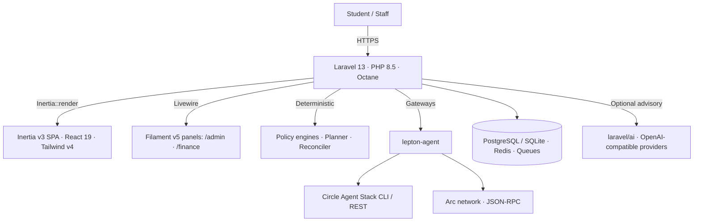
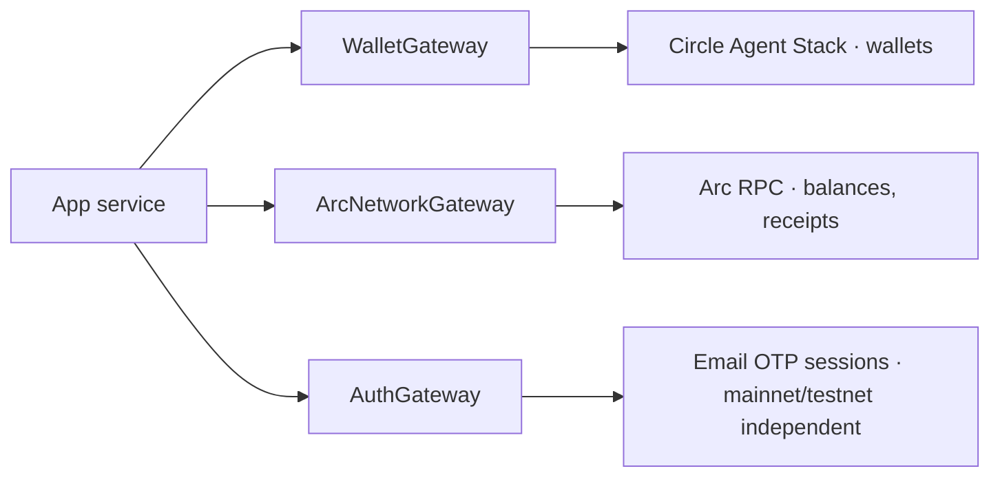

OpenSinop is a **monolithic Laravel application**: server-side stability with a
client-rendered front end, and Filament panels for operations — all on one database and
one auth system.

## High-level design

## Layers

| Layer | Where | Responsibility |
| --- | --- | --- |
| HTTP / Inertia routes | `routes/web.php`, `routes/settings.php` | Student & staff SPA pages, finance evidence endpoints, webhook route |
| Filament panels | `app/Filament` (Resources, Pages, Clusters, Widgets) | Admin at `/admin`, Finance at `/finance` |
| Actions | `app/Actions` | Use-case commands: capture, review, prepare, activate, authorise, reserve, release |
| Policies (business rules) | `app/Policies` | Invoice and assistance policy evaluation |
| Services | `app/Services` | Domain orchestration: planning, affordability, settlement verification, submission, mandates, treasury |
| Jobs | `app/Jobs` | Queued processing: assessments, evaluations, submissions, receipt reconciliation |
| Models & DTOs | `app/Models`, `app/DTOs`, `app/Enums` | Evidence records, exact `Money` DTO, state enums |
| AI layer | `app/Ai` (`Advisory`, `Agents`, `Tools`, `Approvals`) | Optional advisory with fail-closed gates |
| Settlement gateway | `yukazakiri/lepton-agent` + `app/Services/CircleAgentWalletCli` | Circle/Arc access; the app never shells out itself |
| Modules | `Modules/Blog` (nwidart) | Optional feature module, enabled via `modules_statuses.json` |

## The settlement boundary

All gateway bindings are **scoped**, so they are safe under Laravel Octane and do not
leak request state between requests. `CircleCliGateway::transfer()` requires a tx hash
and throws without one — a Circle agent wallet returns a transaction *id* first, so the
working path is quiet submit → poll → hash → verify.

## Domain model (evidence spine)

The finance domain is organised around immutable, digest-bound evidence:

| Group | Models |
| --- | --- |
| Collections | `CollectionBatch`, `CollectionBatchReview` |
| Bills & sources | `Invoice`, `InvoiceVersion`, `InvoiceVersionReview`, `Vendor`, `VendorDestinationVersion`, `VendorDestinationApproval` |
| Budgets & cash | `Budget`, `BudgetSnapshot`, `FundingWindow`, `FundingWindowApproval`, `PaymentReservation`, `PaymentReservationRelease` |
| Payments | `PaymentIntent`, `PaymentIntentChange`, `PaymentAuthorization`, `PaymentSubmissionOutbox`, `PaymentSubmissionAttempt`, `RecurringMandate`, `MandateOccurrence`, `Transaction` |
| Policy | `FinancePolicyVersion`, `FinancePolicyActivation`, `InstitutionPolicyVersion`, `InstitutionPolicyEvaluation`, `AssistancePolicyVersion` |
| Students | `Student`, `TuitionAccount`, `StudentWallet`, `StudentWalletFunding`, `StudentBill`, `StudentBillPayment`, `StudentTuitionPayment`, `StudentTuitionPaymentIntent`, `StudentTuitionPaymentAttempt` |
| AI | `AiProvider`, `AgentDecision`, `ChatSession`, `ChatMessage` |
| Audit & identity | `User`, `Organization`, `Role`, activity log, `SocialAccount` |

## Runtime and deployment

- **Octane** — the app bootstraps once and serves many requests; never store
  request-specific state in singletons or statics.
- **Queues** — named queues per lane: `finance-submission`, `finance-planning`,
  `student-tuition`, `student-bills`, `finance-mandate`, `policy-assessments`,
  `default`. Run workers on each queue you enable.
- **Scheduler** — `routes/console.php`, every tick gated on its own flag (see
  [Workflows](/guides/workflows/#background-runtime)).
- **Docker** — `docker/Dockerfile` builds a multi-stage image (Composer vendor stage,
  Bun asset stage, FrankenPHP runtime) managed by Supervisor; `Dockerfile` at the root
  builds the same production image and `docker-compose.yml` pairs it with PostgreSQL 16
  and Redis 7.

## AI structure

`app/Ai` is optional and fail-closed:

- `Advisory` — `AdvisoryGate`, `AdvisoryEnvelope`, `AdvisorySanitizer`, `BriefGuard`,
  `QnaGate`, `StudentBrief`
- `Agents` — `InstitutionPolicyAnalyst`, `TreasuryAnalyst`, `AssistanceAssessor`,
  `BillClassifier`, `AskEduFlowAgent`, `AdminAssistantAgent`, `SettlementOperatorFactory`
- `Tools` — `InspectInstitutionFinance` (read-only), `DisburseAssistance` (approvable),
  admin read-only tools
- `Approvals` — pause/resume gates for human approval of a paused tool call

Institution finance inspection requires no students, aid fund or AI provider; an
`InspectInstitutionFinance` tool is read-only and reports `can_execute=false`.